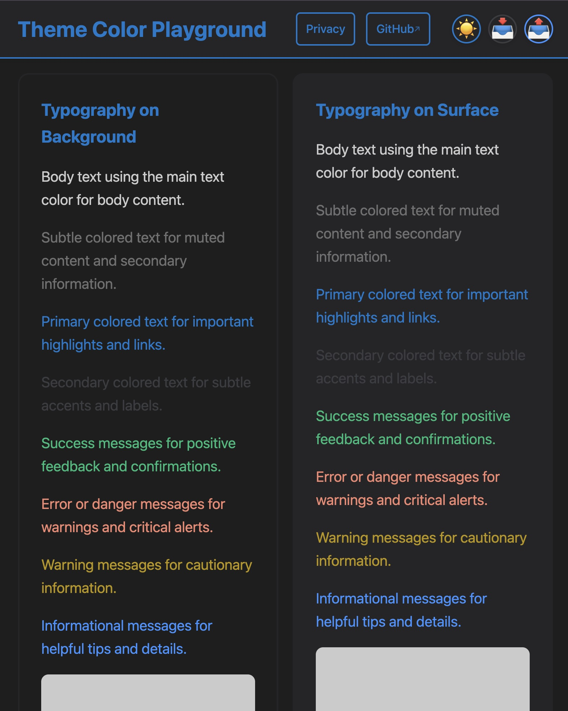
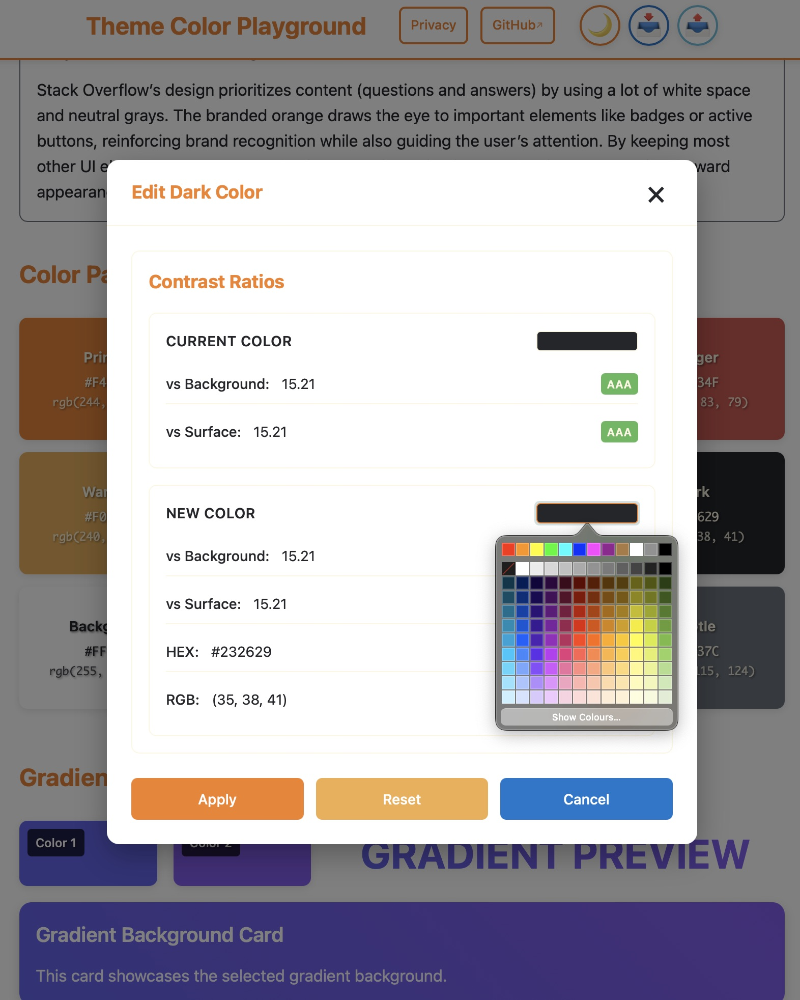

## Build a colour system you can inspect

Theme Color Playground is a browser-based tool for exploring the colours that make up a light and dark interface. It brings colour picking, live preview, gradients, brand references, and JSON import/export into one focused workspace.

The project began as a personal tool for testing design tokens. It is now a live, framework-free playground for designers and developers who want to make deliberate theme choices before embedding them in an application.

## From a chosen colour to a usable theme

```text
Pick a colour → preview it in light and dark themes → compare contrast and mood
             → refine a palette or gradient → export the configuration as JSON
```

The interface updates immediately as colours change, so the system can be assessed in context instead of as isolated swatches.



## What the playground includes

- **Dual-theme preview:** test a colour system in light and dark modes.
- **Live colour picking:** see token changes across the interface as you make them.
- **Gradient exploration:** blend colours and receive suggestions from the first selected colour.
- **Brand palette references:** browse a curated collection of brand-inspired colour systems for comparison.
- **JSON import and export:** keep, share, or reuse a theme configuration.
- **Responsive and accessible foundations:** mobile-first layout, semantic HTML, and contrast-aware design choices.



## Built with browser fundamentals

The application uses Astro for static delivery, vanilla JavaScript for interaction, and CSS custom properties for the theme system. The result keeps the runtime small while leaving the exported colour data portable.

```json
{
  "light": { "primary": "#006564" },
  "dark": { "primary": "#00D9A8" }
}
```

## Use it for

- Establishing colour tokens for a new website or application.
- Testing a brand colour across light and dark surfaces.
- Exploring gradients before committing them to a design system.
- Sharing a small, reusable theme configuration with a project.

Try the [live playground](https://ferrywl.to/theme-color-playground/) or explore the [source repository](https://github.com/ferrywlto/theme-color-playground). The project is released under the [AGPL-3.0 license](https://github.com/ferrywlto/theme-color-playground/blob/main/LICENSE.md).
